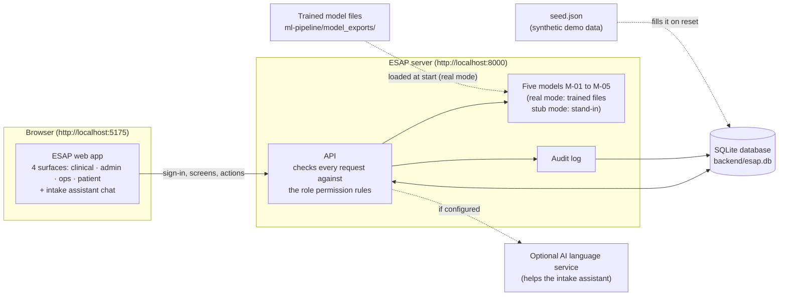
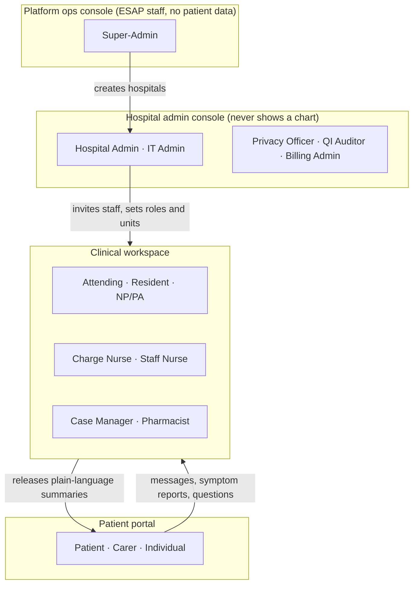
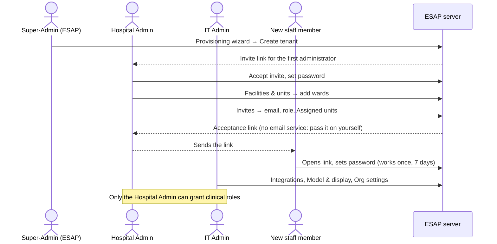
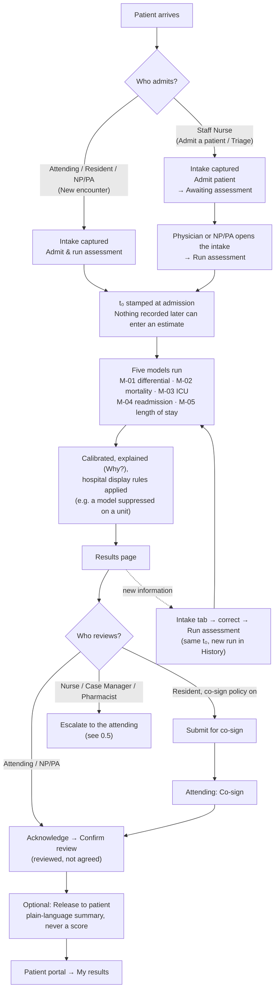
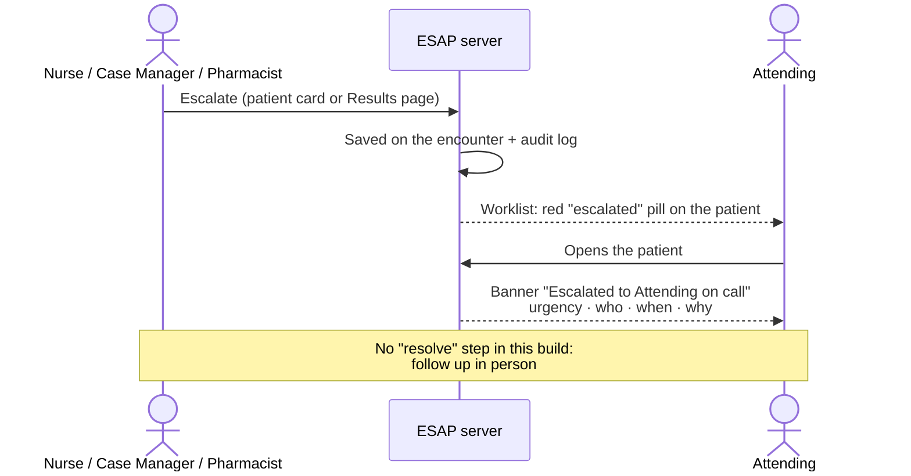
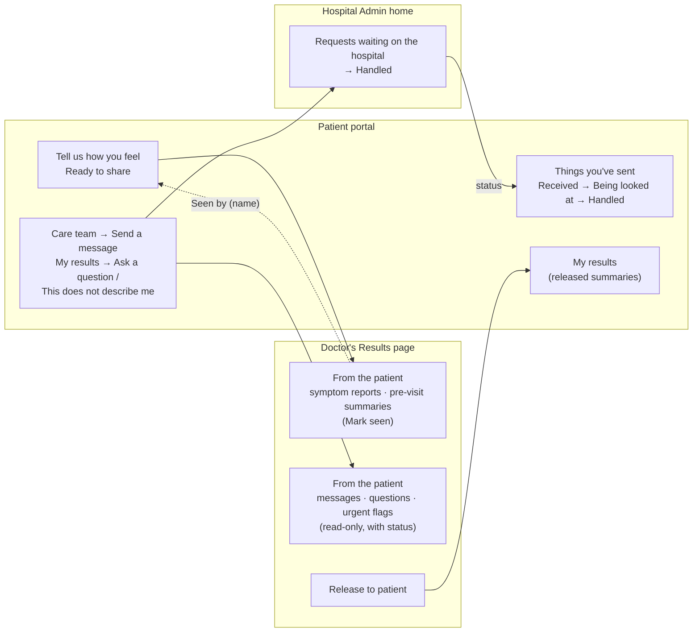
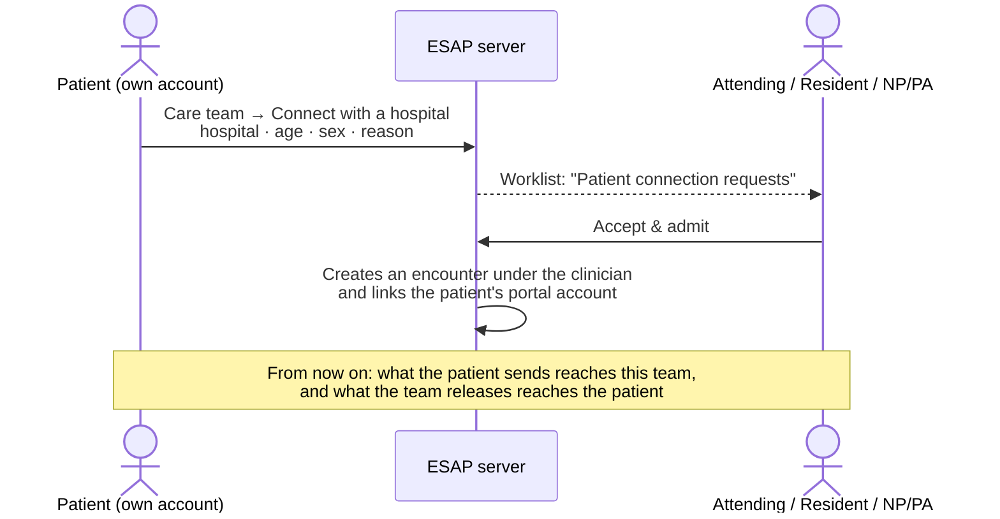
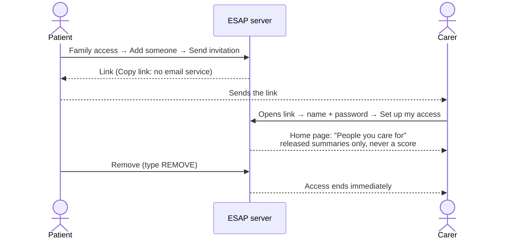
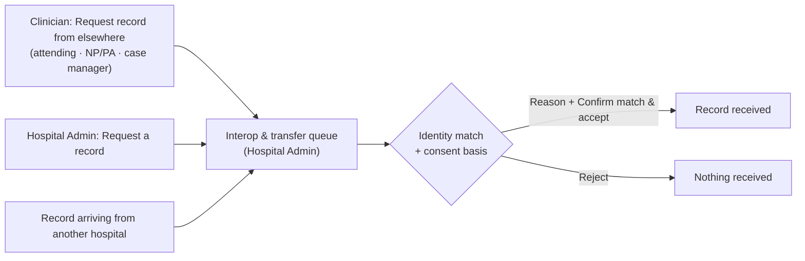
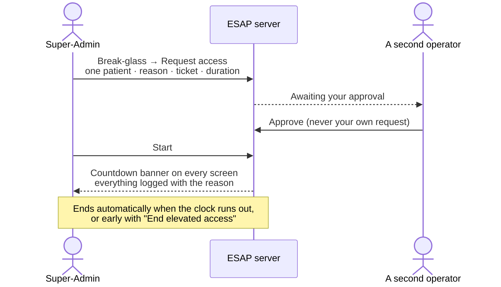

# 0. How the system works: an overview

[← Manual index](README.md)

A picture of the whole system before you read the role chapters: what the parts are, how a
patient moves through it, and how information flows between people. Each section names the
chapter with the details.

> The diagrams are written in Mermaid. They display as diagrams on GitHub and in the VS Code
> Markdown preview (Ctrl+Shift+V). A plain-text summary follows each one.

---

## 0.1 The parts of the system

- **The web app** is what everyone uses. It only shows the screens and buttons a role can use.
- **The server** decides everything: who may see or do what, running the models, saving, and
  writing every action to the **audit log**.
- **All data** lives in one SQLite file, `backend/esap.db`, filled with synthetic patients
  from `seed.json` when the demo is reset. No real patients, no MIMIC records.
- **The models** are the trained M-01 to M-05 files in real mode, or a stand-in in stub mode
  ([About this build](README.md#about-this-build)).
- **The AI language service** is optional. It only makes the intake assistant's replies more
  natural; if it is down, the assistant still works.

---

## 0.2 The four surfaces and who uses them

- **Ops** creates each hospital. The **Hospital Admin** then invites staff and gives each one a
  role and units.
- **Clinicians** assess patients and release summaries to the **patient portal**. Patients
  send information back.
- Details: roles at a glance in the [README](README.md#roles-at-a-glance); exact permissions
  in [chapter 10](10-permissions-reference.md).

---

## 0.3 Setting up a hospital (once)

1. ESAP staff create the hospital; its first administrator gets an invite
   ([chapter 8](08-platform-operations.md)).
2. The Hospital Admin adds units, then invites staff with a role and **Assigned units**. Units
   decide which patients a unit-scoped clinician sees ([chapter 6](06-hospital-admin-and-it-admin.md)).
3. The IT Admin configures integrations and settings, and can provision non-clinical accounts.

---

## 0.4 The core workflow: from admission to a reviewed result

This is what the product exists for.

- **Admit:** a Staff Nurse captures the intake but cannot run the models; the patient waits as
  *Awaiting assessment*. A physician or NP/PA can admit and assess in one step
  ([chapter 3](03-physicians.md), [chapter 4](04-nurses.md)).
- **t₀:** the admission time is fixed. Everything the models use was known at that moment.
- **Assess:** all five models run together. Each result is calibrated, explained, and shown
  according to your hospital's **Model & display** settings.
- **Review:** acknowledging records that a named clinician reviewed it. Residents may need an
  attending's co-sign. Other roles escalate instead ([chapter 2](02-reading-a-result.md)).
- **Share:** the clinician can release a summary in their own words to the patient portal.
- **Re-run:** new information goes on the Intake tab; a new run is added against the same t₀,
  and **History** shows what changed.

---

## 0.5 Escalation: asking the attending to look

---

## 0.6 Patient ↔ care team communication

- **Symptom reports and pre-visit summaries** go to the doctor's **From the patient** panel;
  **Mark seen** tells the patient who read it.
- **Messages, result questions and urgent flags** appear in the doctor's panel (read-only) and
  in the Hospital Admin's request queue, which marks them **Handled**. The patient follows the
  status under **Things you've sent**.
- **Released summaries** are the only clinical content a patient sees. They never show a
  score, and nothing a patient sends ever changes an estimate.
- Details: [chapter 9](09-patients-and-carers.md), [chapter 3, section 3.3](03-physicians.md#33-results).

---

## 0.7 A self-registered patient joins a hospital

---

## 0.8 A family member or carer gets access

---

## 0.9 Records between hospitals

Every transfer needs a consent basis and a human identity check; below the match threshold a
person must always decide. How far transfers can reach depends on the hospital's plan
([chapter 6, section 6.9](06-hospital-admin-and-it-admin.md#69-interop--record-transfer-hospital-admin)).

---

## 0.10 Emergency access by ESAP staff (break-glass)

ESAP staff have no standing access to any patient. A hospital can switch this route off in
**Org settings** ([chapter 8, section 8.6](08-platform-operations.md#86-break-glass)).

---

## 0.11 The rules the whole system follows

| Rule | What it means for you |
|---|---|
| **Admission-time cut (t₀)** | Only what was known at admission reaches a model. Later results are saved to the chart but never used. |
| **Decision support, not diagnosis** | Every estimate describes similar past admissions. A clinician reads it and decides. |
| **Calibrated and explained** | Each number has a calibration badge and a **Why?** panel computed from the model itself. |
| **Fairness** | Race, insurance and marital status are recorded only for the fairness audit, never used by a model. |
| **Role-based access** | You see only what your role needs; the server enforces it on every request. |
| **Everything is audited** | Views, changes, exports and refusals all go to the audit log. |
| **Patients never see a score** | The portal shows only summaries a clinician wrote and released. |

Next: [1. Signing in and finding your way →](01-signing-in-and-navigation.md)
